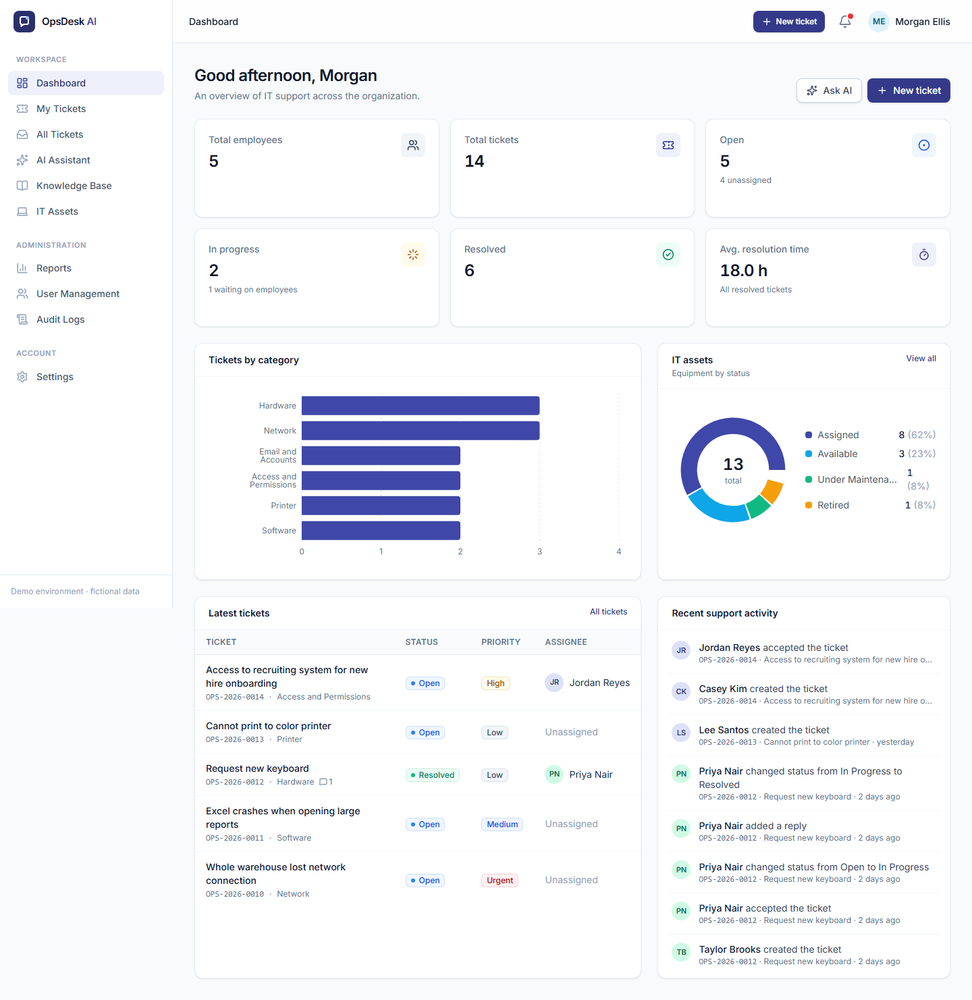
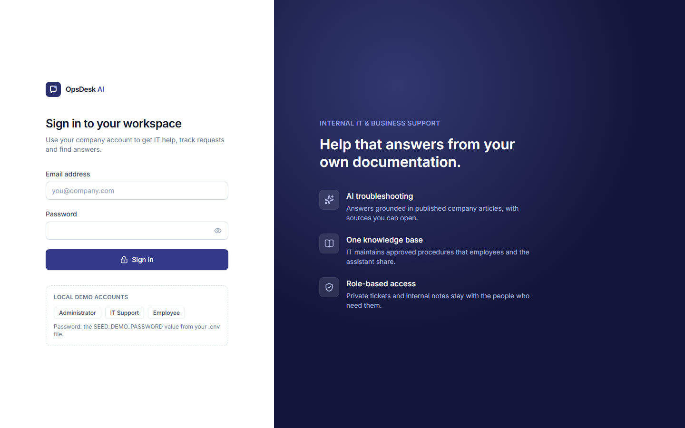
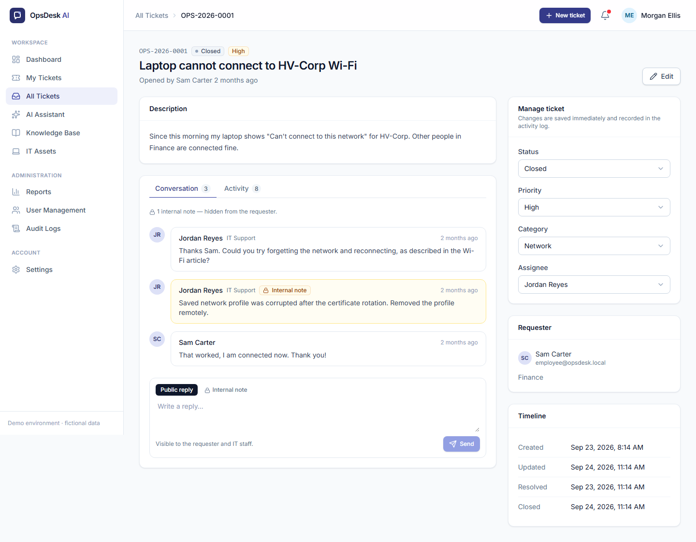
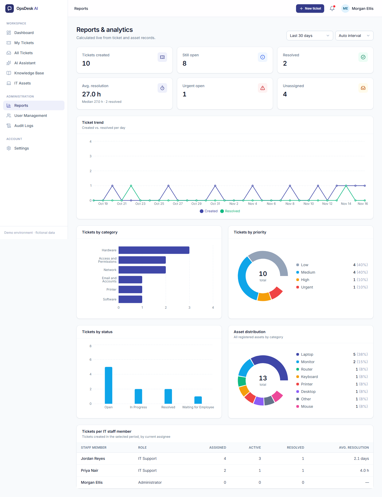
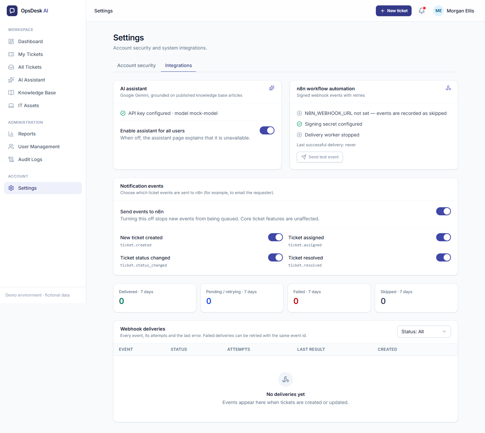
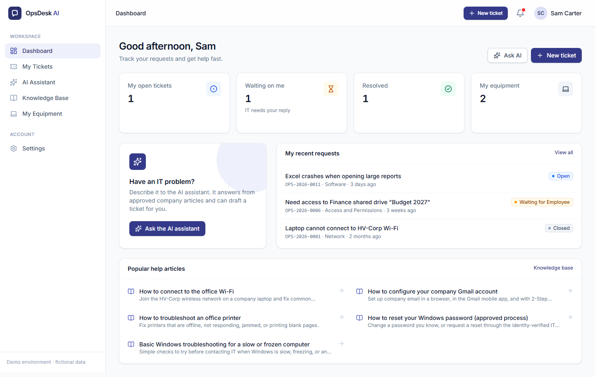
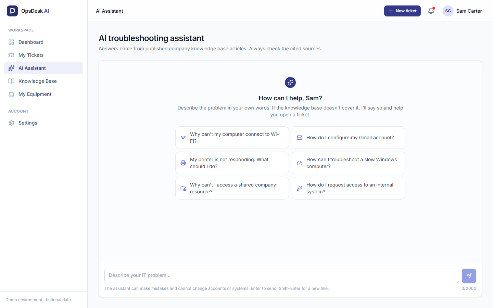
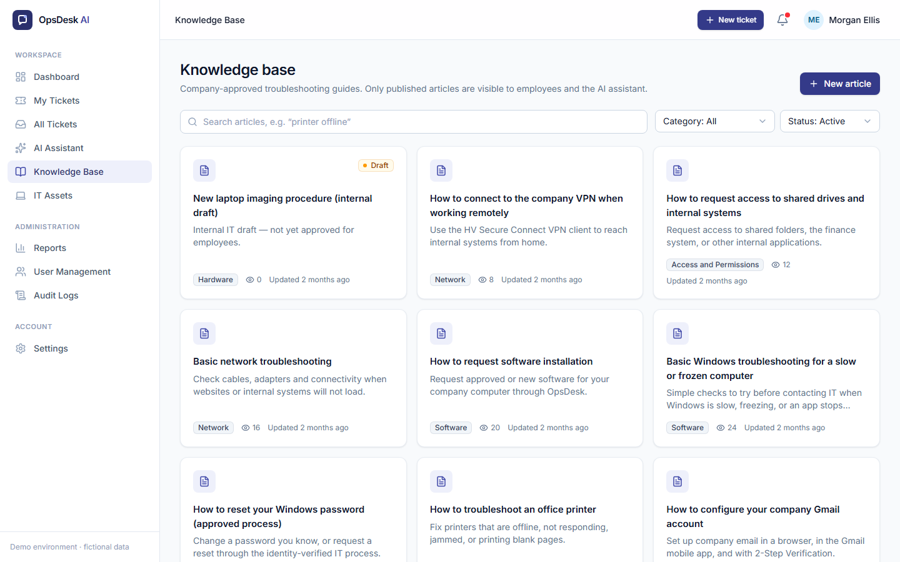
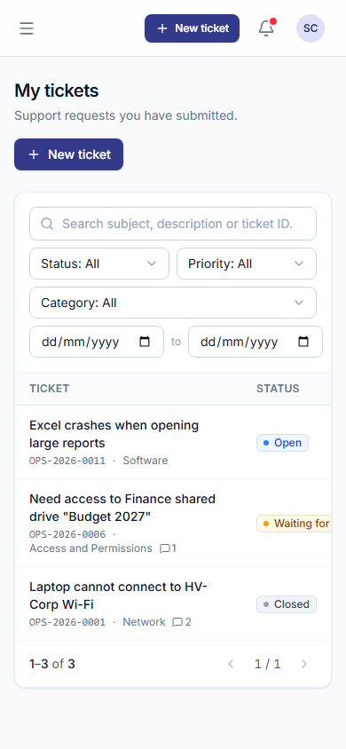

# OpsDesk AI

**An AI-powered IT and business support portal for small and medium-sized businesses.** Employees submit and track IT tickets, search the company knowledge base and get troubleshooting help from an AI assistant that answers *only* from approved, published documentation, with source links. IT staff run the ticket queue, maintain documentation and manage hardware. Administrators manage users, review reports and audit trails, and control the AI and n8n automation.



> All data in this repository is **fictional demo data** for a made-up company. Demo accounts and passwords are for local development only.

## Highlights

- **Grounded AI troubleshooting.** PostgreSQL full-text retrieval over *published* articles feeds Google Gemini. The server (not the model) decides which sources are cited, removes steps that have no supporting article, and tells employees honestly when the knowledge base has no answer. The assistant can draft a ticket from the chat, and the employee reviews it before anything is submitted.
- **Real role-based security.** Three roles are enforced in the API, not just hidden in the UI. Private tickets return 404 to other employees, even when the id is guessed. Internal notes never reach employees. Sessions are server-side and HTTP-only, with synchronizer-token CSRF protection, bcrypt password hashing, rate limiting, Helmet headers and an append-only audit log protected by database triggers.
- **Reliable automation.** Ticket events use a transactional outbox → HMAC-signed webhooks → n8n → Gmail. Delivery retries with exponential backoff and idempotent event ids, and an admin delivery monitor offers one-click retry. n8n being down never affects tickets.
- **Live analytics.** Role-specific dashboards and reports (bar, line and donut charts plus tables) are computed from SQL, with date filters.
- **Professional, responsive UI.** React 19, Tailwind CSS 4 and accessible components, with loading, empty, error and success states on every page. Verified for overflow at 1440/1024/768/390 px.
- **Tested.** 113 API tests and 24 Playwright end-to-end tests, all passing. See [docs/testing.md](docs/testing.md).

## Tech stack

| Layer | Technology |
| --- | --- |
| Frontend | React 19, Vite 8, JavaScript, Tailwind CSS 4, React Router 8, TanStack Query 5, React Hook Form, Recharts 3, Lucide icons |
| Backend | Node.js 24, Express 5, `pg`, express-session + connect-pg-simple, bcrypt, express-validator, Helmet, express-rate-limit |
| Data | PostgreSQL 17 (UUID keys, FTS, triggers, generated columns) |
| AI | Google Gemini REST API behind a provider abstraction, PostgreSQL full-text retrieval |
| Automation | n8n (signed webhooks → Gmail) |
| Testing | Node test runner + Supertest, Playwright |
| Infrastructure | Docker, Docker Compose, nginx |

## Quick start (Docker)

Prerequisites: Docker Desktop.

```bash
cp .env.example .env
```

Edit `.env` and set at least `POSTGRES_PASSWORD` (also update it inside `DATABASE_URL`/`TEST_DATABASE_URL`), a long random `SESSION_SECRET`, and `SEED_DEMO_PASSWORD`. Generate secrets with:

```bash
node -e "console.log(require('crypto').randomBytes(48).toString('hex'))"
```

```bash
docker compose up -d --build
```

```bash
docker compose exec api node src/database/seed.js
```

Open **http://localhost:8080** and sign in with a demo account (password = `SEED_DEMO_PASSWORD`):

| Role | Email |
| --- | --- |
| Administrator | `admin@opsdesk.local` |
| IT Support | `support@opsdesk.local` |
| Employee | `employee@opsdesk.local` |

To enable the AI assistant, set `GEMINI_API_KEY` (and optionally `GEMINI_MODEL`) in `.env`, then run `docker compose up -d api`. Without a key, the assistant clearly says it is not configured and offers the knowledge base and ticket creation instead.

To enable email notifications, see [docs/n8n.md](docs/n8n.md).

## Local development

Prerequisites: Node.js ≥ 22.12 (developed on 24), npm, Docker (for PostgreSQL).

```bash
cp .env.example .env
```

```bash
npm run setup
```

```bash
npm run db:up
```

```bash
npm run db:reset
```

Run the API (http://localhost:4000) and the web app (http://localhost:5173) in two terminals:

```bash
npm run dev:api
```

```bash
npm run dev:web
```

In development the login page shows buttons that fill in a demo email. The password is still your `SEED_DEMO_PASSWORD`.

## Environment variables

All configuration comes from environment variables. See [.env.example](.env.example) for the full list with placeholder values. **Never commit `.env`.**

| Variable | Purpose |
| --- | --- |
| `DATABASE_URL`, `TEST_DATABASE_URL` | PostgreSQL connections. The test database name must contain `test`. |
| `POSTGRES_USER` / `POSTGRES_PASSWORD` / `POSTGRES_DB` / `POSTGRES_PORT` | Docker database container |
| `SESSION_SECRET` | ≥ 32 chars, signs the session cookie (startup fails if missing) |
| `SESSION_MAX_AGE_HOURS` | Rolling session lifetime (default 8) |
| `COOKIE_SECURE` | `true` behind HTTPS. Required in production. |
| `TRUST_PROXY` | `true` behind a reverse proxy (set automatically in Docker) |
| `CORS_ORIGINS` | Allowed browser origins (the SPA is normally same-origin) |
| `SEED_DEMO_PASSWORD` | Password for the fictional demo accounts (seeding refuses to run in production) |
| `GEMINI_API_KEY`, `GEMINI_MODEL` | Enable the AI assistant (server-side only, never sent to the browser) |
| `AI_TIMEOUT_MS`, `AI_RATE_LIMIT_PER_MINUTE` | AI request timeout and per-user limit |
| `N8N_WEBHOOK_URL`, `N8N_WEBHOOK_SECRET` | Outbound webhook target and HMAC signing secret |
| `WEBHOOK_TIMEOUT_MS`, `WEBHOOK_MAX_ATTEMPTS`, `WEBHOOK_POLL_INTERVAL_MS` | Delivery tuning |
| `APP_BASE_URL` | Base URL for links inside notification emails |
| `AUTH_RATE_LIMIT_MAX`, `AUTH_RATE_LIMIT_WINDOW_MINUTES` | Failed sign-in limit |

## Testing

```bash
npm run test:api
```

```bash
npm run test:e2e
```

The first E2E run needs `npx --prefix e2e playwright install chromium`, and the test database must exist (`docker compose exec db createdb -U opsdesk opsdesk_test`). Details and the latest results are in [docs/testing.md](docs/testing.md).

## Project structure

```
├── backend/            Express API (modules: auth, users, tickets, knowledge-base, ai, assets,
│   │                   reports, dashboard, audit, integrations, settings)
│   ├── src/database/   migrations, seed data, migration runner
│   └── test/           API test suite
├── frontend/           React SPA (pages, components, hooks, api) + nginx config
├── e2e/                Playwright end-to-end tests
├── n8n/                Importable n8n workflow
├── docs/               Architecture, database, API, n8n, testing, screenshots
└── docker-compose.yml  db, api, web (+ n8n with --profile automation)
```

## Documentation

- [Architecture](docs/architecture.md): components, design decisions, AI request flow
- [Database](docs/database.md): ER diagram, constraints, indexes, full-text search
- [API reference](docs/api.md): every endpoint with roles and rules
- [n8n automation](docs/n8n.md): events, signatures, retries, setup
- [Testing](docs/testing.md): how to run, coverage, results, defects fixed

## Screenshots

| | |
| --- | --- |
|  |  |
|  |  |
|  |  |
|  |  |

## Production notes

- Serve over HTTPS and set `NODE_ENV=production` and `COOKIE_SECURE=true` (the API refuses to start in production without secure cookies).
- Do **not** run the seed in production (it refuses), and create real administrator accounts instead of the demo accounts.
- Keep secrets in your platform's secret manager. Only non-secret toggles are stored in the database.
