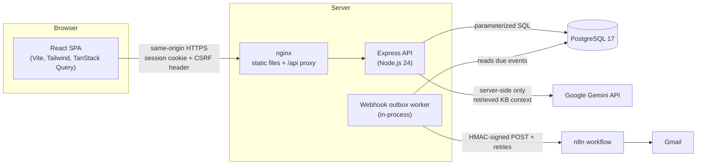
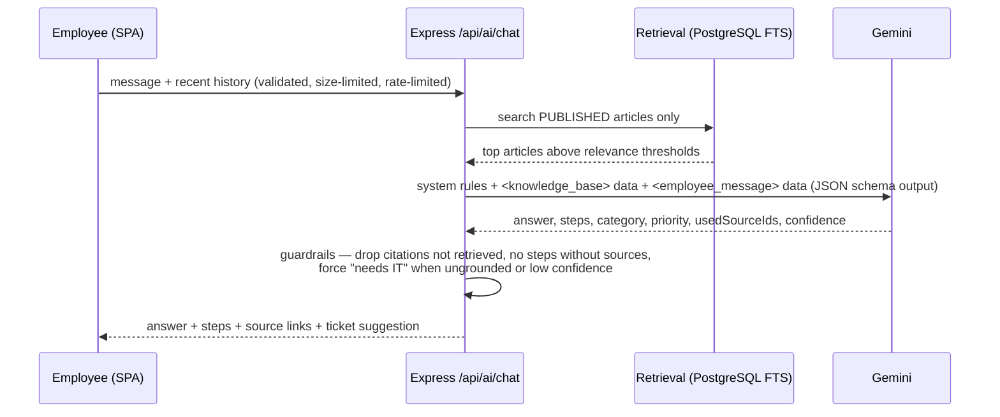

# Architecture

OpsDesk AI is a single-repository, three-tier web application. It deliberately avoids microservices, Redis or Kubernetes: one Express API, one PostgreSQL database and one static React app cover every requirement, and the n8n integration is an optional sidecar.



## Key decisions

| Decision | Why |
| --- | --- |
| **Same-origin API** (Vite proxy in dev, nginx in Docker) | The session cookie stays first-party with `SameSite=Lax`, so no third-party cookies and no permissive CORS are needed. |
| **Server-side sessions in PostgreSQL** (`express-session` + `connect-pg-simple`) | Sessions can be revoked instantly (logout, deactivation, password change) and nothing secret is held in the browser except an HTTP-only cookie. |
| **Synchronizer-token CSRF** | The token lives in the session and must be echoed in `X-CSRF-Token` on every state-changing request; `csurf` is deprecated so this is a small, audited middleware. |
| **Authorization in one policy module** (`tickets.policy.js`) | Every ticket rule (visibility, editable fields, status transitions, internal notes) is enforced server-side in one place. Unauthorized ticket ids return **404**, so ids cannot be probed. |
| **Plain SQL + `pg`** with a tiny migration runner | Transparent, parameterized queries and real PostgreSQL features (full-text search, generated columns, triggers, `FOR UPDATE SKIP LOCKED`) without ORM abstraction. |
| **Transactional outbox for webhooks** | The event row is written in the *same transaction* as the ticket change. A background worker delivers it later, so n8n outages never block or roll back ticket operations. |
| **AI provider abstraction** (`ai.provider.js`) | Routes and UI never talk to Gemini directly. The mock provider exists only under `NODE_ENV=test`. |
| **Retrieval with PostgreSQL full-text search** | Weighted `tsvector` (title A, summary/tags B, body C), OR-relaxed queries ranked with `ts_rank`, absolute + relative thresholds tuned against the corpus (`backend/scripts/probe-retrieval.js`). |

## Backend layout

```
backend/src
├── app.js / server.js          Express app factory and process entry point
├── config/env.js               Typed environment configuration + startup validation
├── database/                   pool, migration runner, SQL migrations, seed data
├── middleware/                 auth, CSRF, validation, rate limits, error handler
├── modules/
│   ├── auth/                   login, logout, me, profile, password change
│   ├── users/                  admin user management + admin router
│   ├── tickets/                policy, service, routes
│   ├── knowledge-base/         CRUD, slugs, full-text search, related articles
│   ├── ai/                     provider abstraction, Gemini + mock providers, prompts, retrieval
│   ├── assets/                 assets + asset history
│   ├── reports/ dashboard/     SQL aggregations
│   ├── audit/                  append-only audit log
│   ├── integrations/           webhook outbox, delivery worker, admin status
│   └── settings/               admin-editable non-secret settings
├── routes/index.js             mounts modules, global auth boundary
└── utils/                      errors, constants, pagination/SQL helpers, validators
```

Routes validate input with `express-validator` and pass only declared fields (`req.validated`) to services. Services own SQL and business rules. Errors are `AppError`s with stable codes; the central error handler maps PostgreSQL errors (unique/foreign-key/check violations) to safe 4xx responses and never leaks stack traces.

**Response format.** Success: `{ "data": ..., "meta"?: { page, pageSize, total, totalPages } }`. Error: `{ "error": { "code", "message", "details"? } }`.

## AI request flow



Prompt-injection defenses: trusted rules live only in the system instruction; article and user text are wrapped in data tags with closing-tag sequences neutralized; the model is told to treat that content as untrusted; and the **server**, not the model, decides which sources are cited and whether steps may be shown. The assistant has no tools and cannot change any system state.

## Frontend layout

```
frontend/src
├── api/            fetch wrapper (CSRF, errors) + one function per endpoint
├── context/        auth, toasts, breadcrumbs
├── hooks/          URL-synced filters, debounced search, mutation helper
├── components/
│   ├── layout/     AppLayout (route guard), Sidebar, Topbar, ErrorBoundary
│   ├── ui/         Button, Badges, DataTable, Modal, ConfirmationDialog, Form fields, States…
│   ├── tickets/ ai/ kb/ assets/ charts/
└── pages/          one file per route (lazy-loaded)
```

Server state lives in TanStack Query; list filters live in the URL so views are shareable. Pages are code-split; the chart library loads only on pages that use it. Frontend role checks only hide UI. Every rule is enforced again by the API.
