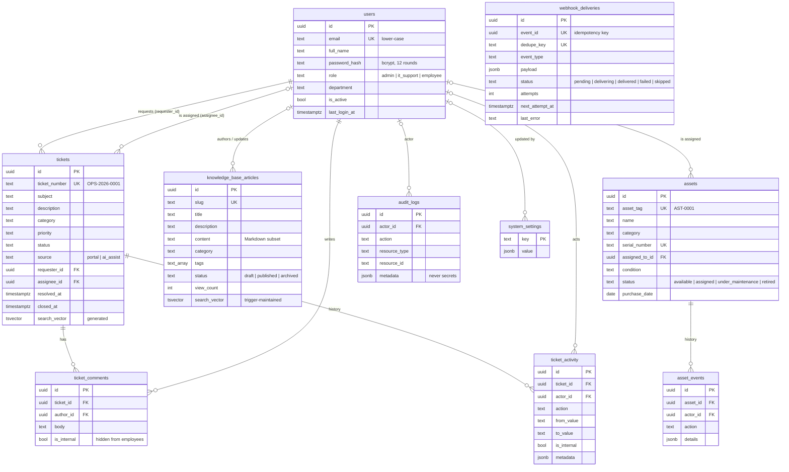

# Database design

PostgreSQL 17. Schema: [`backend/src/database/migrations/001_initial_schema.sql`](../backend/src/database/migrations/001_initial_schema.sql). All primary keys are UUIDs (`gen_random_uuid()`); enumerations are `TEXT` + `CHECK` constraints so they can evolve with a simple migration.

## Entity relationships



Supporting tables: `ticket_counters` (per-year sequence for readable ticket numbers, incremented with a row-locking upsert), `session` (connect-pg-simple), `schema_migrations`.

## Integrity rules enforced by the database

| Rule | Mechanism |
| --- | --- |
| Unique, lower-case emails | `UNIQUE` index + `CHECK (email = lower(email))` |
| Readable, gap-free ticket numbers under concurrency | `ticket_counters` upsert inside the creating transaction |
| An asset is "assigned" exactly when it has an owner | `CHECK ((status = 'assigned') = (assigned_to_id IS NOT NULL))` |
| Audit log is append-only | `BEFORE UPDATE OR DELETE` and `BEFORE TRUNCATE` triggers raise an exception |
| Users with history cannot be hard-deleted | `ON DELETE RESTRICT` from tickets, comments and audit logs (users are deactivated instead) |
| Comments and activity disappear with their ticket | `ON DELETE CASCADE` |
| Webhook events are queued once | `UNIQUE (dedupe_key)` + `ON CONFLICT DO NOTHING` |
| `updated_at` is always current | `set_updated_at()` trigger on mutable tables |

## Indexes

- **tickets**: `(requester_id, created_at DESC)`, `(assignee_id, status)`, `status`, `priority`, `category`, `created_at DESC`, GIN on `search_vector`.
- **knowledge_base_articles**: `(status, category)`, GIN on `search_vector`, GIN on `tags`.
- **ticket_comments / ticket_activity**: `(ticket_id, created_at)`.
- **assets**: `(category, status)`, `assigned_to_id`.
- **audit_logs**: `created_at DESC`, `(actor_id, created_at DESC)`, `(resource_type, resource_id)`, `action`.
- **webhook_deliveries**: partial index on `next_attempt_at WHERE status IN ('pending','delivering')` for the worker's claim query.

## Full-text search

- Tickets: generated column `setweight(to_tsvector(number + subject), 'A') || setweight(to_tsvector(description), 'B')`, queried with `websearch_to_tsquery` (supports quotes and `-exclusions`) plus an `ILIKE` fallback for ticket numbers.
- Knowledge base: trigger-maintained vector (title A, summary + tags B, content C). `array_to_string` is not `IMMUTABLE`, so a generated column is not possible.
- AI retrieval converts the question with `plainto_tsquery`, relaxes `&` to `|`, ranks with `ts_rank(…, 1)` and keeps results with rank ≥ 0.03 **and** ≥ 40% of the best match. These values were tuned with `node backend/scripts/probe-retrieval.js`.

## Migrations and seed data

```bash
npm --prefix backend run db:migrate   # apply pending migrations (idempotent)
npm --prefix backend run db:seed      # load FICTIONAL demo data (refuses in production or if users exist)
npm --prefix backend run db:reset     # drop + migrate + seed (refuses in production)
```

The seed creates 9 users (3 roles, 1 deactivated), 11 knowledge base articles (9 published, 1 draft, 1 archived), 14 tickets spread over the last ~2 months with comments, internal notes and activity, and 13 assets with history. Every name, device, network and procedure is fictional ("Harborview Logistics").
